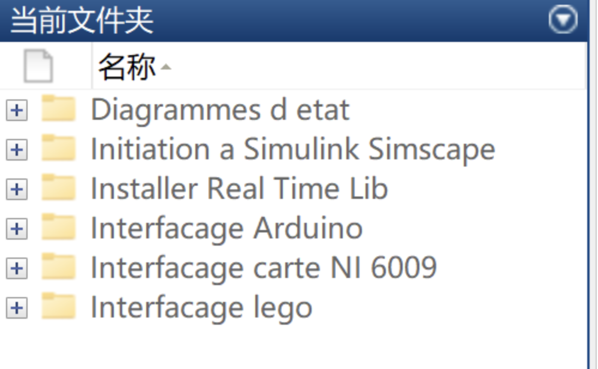

# [Simulink, Simscape] Using StateFlow for State Chart Design

- Simulink/Simscape environment;
- Use StateFlow for state diagram design;
- Utilize NI 6009 board for data acquisition;
- Connect to Arduino UNO board;
- Connect to Lego Mindstorms.

## Images

<!-- PAYMENT_BLOCK -->

## Get this dataset

- Payment link (Stripe): [Buy now](https://buy.stripe.com/3cs8yP7sY87d0vu9AB)
- Payment QR code: 

<!-- /PAYMENT_BLOCK -->
